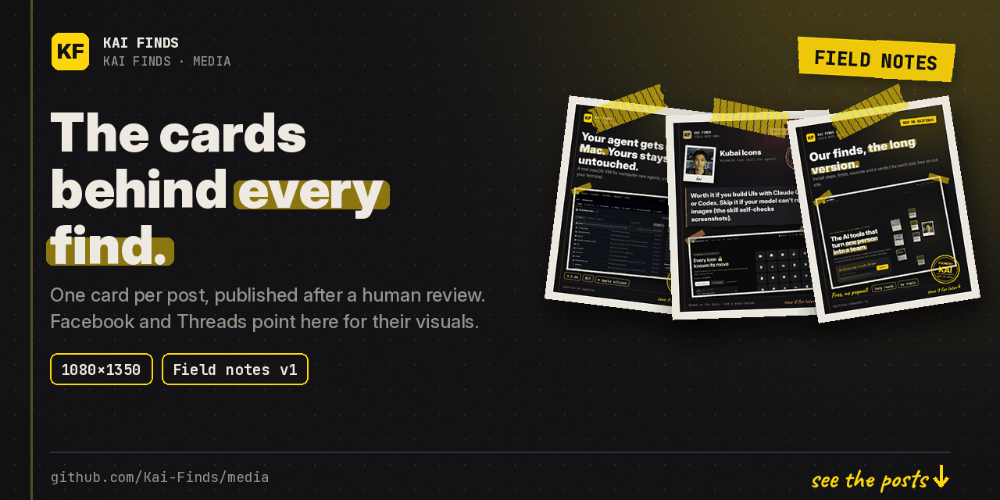
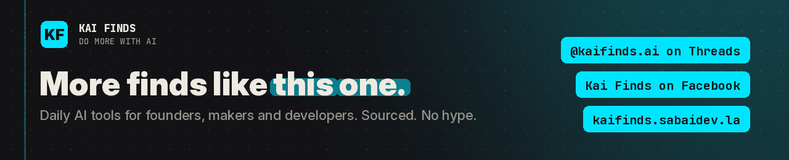

# Kai Finds · media

**The image cards behind every Kai Finds post.**
Facebook and Threads posts point here for their visuals. One card per post, nothing else.

## What's inside

| Path | Contents |
| --- | --- |
| `cards/<YYYY-MM>/` | Post cards, named `kaifinds-<draft>-<hash>.png` |
| `reels/<YYYY-MM>/` | Short video assets for reels |
| `privacy.html` | Privacy policy and data deletion page for the Kai Finds apps |

Files are published by the Kai Finds pipeline after a human review. They are not edited by hand.

## Using a card

Want to share one? Link to the original post on [Threads](https://www.threads.com/@kaifinds.ai) or [Facebook](https://www.facebook.com/122105394627540019) so the sources travel with it. Tool names and logos on the cards belong to their owners.

Spotted a mistake on a card? Open an issue with the file name and the right source. We correct publicly.

---

<b>Kai Finds</b> · Do more with AI · The AI tools that turn one person into a team. 
Sourced. No hype. Every claim here points to something you can check. 
<a href="https://kaifinds.sabaidev.la">kaifinds.sabaidev.la</a> · <a href="https://www.threads.com/@kaifinds.ai">Threads</a> · <a href="https://www.facebook.com/122105394627540019">Facebook</a> · <a href="https://github.com/Kai-Finds">All repos</a>

